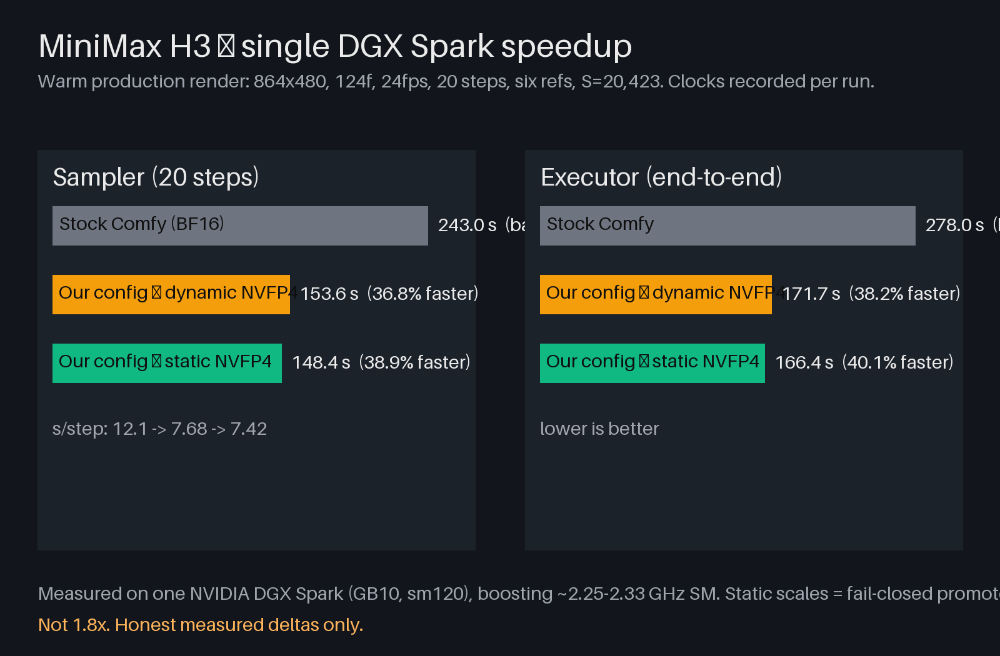

# MiniMax H3 — single DGX Spark (GB10) serving package

Complete serving package for running MiniMax H3 video generation on a
single NVIDIA DGX Spark, at serving speed. Two parts:

> **Repository hub:** the canonical source tree, install script, demo
> footage, and issue tracker live on GitHub:
> **https://github.com/newjordan/h3-spark** — start there to actually
> run the system. This HF repo mirrors the same source and hosts the
> serving configuration alongside the weights.

1. **`weights/`** — pruned + NVFP4-quantized checkpoints (modified
   derivatives of the MiniMax H3 weights; see `weights/MODEL_CARD.md`
   and `weights/LICENSE-MiniMax-H3-Community.txt`).
2. **the serving config at the repository root** — ComfyUI integration
   source, native kernels, qualification receipts, and the validated
   serving environment (`config/h3_spark_serving.env`).

## Demo

Four-shot segment generated and served from one DGX Spark (drone orbit
on the wizard -> knight riding solo -> riding together -> wide shot with
a dragon silhouette), with narration voice-over and score mix. Watch it
in the GitHub README (it embeds the video):

**https://github.com/newjordan/h3-spark**

## What this config does

- **H3-scoped SageAttention 2++ quality attention** with real-activation
  calibration (`H3_ATTENTION=sage2-quality`).
- **Exact segmented modulation fusion** (`H3_MODULATION_FUSION=exact`).
- **Native NVFP4 packing** for the Omni-Transformer linears
  (`H3_SWIGLU_NVFP4_FUSION=auto`, `H3_RMS_ADALN_NVFP4_FUSION=auto`) —
  200 NVFP4 linears per evaluation.
- **Promoted Q RMSNorm + rot96 RoPE → Sage Q-INT8** fusion
  (`H3_Q_RMS_ROPE_INT8_FUSION=auto`), byte-exact on default and
  non-default streams.
- **VAE fast path**: same-256px tile-batched decode/encode, SwiGLU
  `silu(gate)*up` native kernel, GPU fp16 host transfer, persistent host
  decode buffer, NHWC staging (`COMFY_MINIMAX_H3_VAE_*`).
- **Step-invariant caches**: rope/cond/mask, audio sinc-filter, ViT3D
  grid caches; identical-reference encode/vision/pack reuse.
- Optional **static NVFP4 activation scales** with fail-closed promotion
  (see `labs/nvfp4_static/`).

## Demo footage (single DGX Spark)

<video controls src="assets/knight_dragon_final.mp4" width="100%"></video>

Four shots generated and served from one DGX Spark (drone orbit -> solo
ride -> riding together -> dragon wide), narration voice-over + score mix.



## Measured on one DGX Spark (dgx-spark-host, GB10, sm120)

Warm fixed-reference workload 20-step render — 864×480, 124 frames at 24 fps, six
references, `S=20,423`, boosting GB10, SM clock recorded in the same
sentence as the time:

| Config | Sampler | % faster | s/step | Executor | % faster | Wall | SM |
|---|---:|---:|---:|---:|---:|---:|---|
| Stock Comfy (BF16 ops) | 243 s | — | 12.1 | ~278 s | — | — | boosting |
| This config, dynamic NVFP4 (2026-08-15) | 153.6 s | **36.8%** | 7.68 | 171.7 s | **38.2%** | 180.2 s | 2300–2330 MHz |
| This config, promoted static NVFP4 scales (2026-08-15, 200/200 layers) | 148.4–149.4 s | **38.5–38.9%** | 7.42–7.47 | 166.4–167.6 s | **39.7–40.1%** | 170.0–170.1 s | 2242–2255 MHz |

The 2026-08-15 static artifact passed the fail-closed promotion gate
(`verify_promotion.py` exit 0): 200/200 static layers, zero excluded
layers, held-out max ratio 0.9873. Static scales are shape-bound and
workload-bound — dynamic NVFP4 is the always-valid default.

## Install

Prereqs: ComfyUI (GPL-3.0), comfy-kitchen ≥ 0.2.27 (Apache-2.0),
SageAttention ≥ 2.2.0 (Apache-2.0), PyTorch 2.13.0+cu130, Triton 3.7.x,
NVIDIA driver ≥ 580, CUDA 13.0. Target: NVIDIA DGX Spark (sm120) or
other Blackwell parts (B200 validation in progress).

```bash
# 1. get the source (canonical clone — GitHub)
git clone https://github.com/newjordan/h3-spark
cd h3-spark

# 2. weights: official upstream MiniMax H3 checkpoints
hf download MiniMaxAI/MiniMax-H3 --local-dir models --include "Ref2VA/*" "FL2VA/*"
mkdir -p models/ComfyUI/models
cp -r models/Ref2VA   models/ComfyUI/models/
cp -r models/FL2VA    models/ComfyUI/models/

# 3. overlay: install the serving source overlay into ComfyUI
bash scripts/install_comfyui_overlay.sh /path/to/ComfyUI

# 4. env: export the validated serving defaults
set -a; source config/h3_spark_serving.env; set +a
```

> Our pruned + NVFP4-quantized derivatives (the numbers in the table
> below) ship as a companion weights package — status and download in
> the GitHub README.


Start ComfyUI with:

```bash
python main.py --listen 127.0.0.1 --port 18188 \
  --models-directory /path/to/models/ComfyUI/models \
  --disable-pinned-memory --fp16-intermediates --highvram \
  --disable-dynamic-vram --fast fp16_accumulation cublas_ops autotune
```

## License and attribution

- **Model weights in `weights/`** are modified derivatives of MiniMax H3
  and are licensed under the **MiniMax H3 Community License Agreement**
  (full text in `weights/LICENSE-MiniMax-H3-Community.txt`, required
  `NOTICE` file alongside). Read it, including the Applicable Territory
  definition and Sections III and V, before use or redistribution.
- Qwen3-VL-32B text encoder: Apache-2.0.
- ComfyUI portions of the serving source: GPL-3.0. comfy-kitchen and
  SageAttention portions: Apache-2.0. See `third_party_licenses/`.
- Original serving-config work: see `docs/PROVENANCE.md`.
